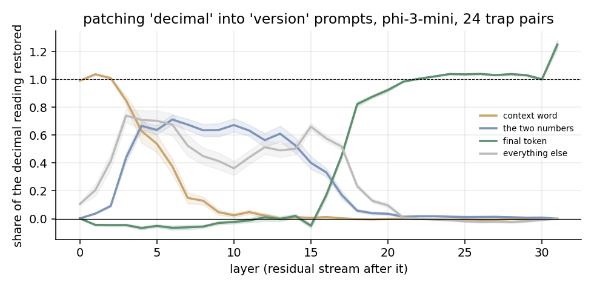

# Why models think 7.11 > 7.8: decimal comparison under ambiguity

A small mechanistic interpretability study of a well-known failure: language models sometimes say 7.11 is larger than 7.8. As decimals, 7.8 is larger; as version numbers (or chapter numbers), 7.11 comes later. Which answer is "right" depends on how the context is read, and the question is where in the network that reading lives.

Model: `microsoft/Phi-3-mini-4k-instruct`, run in fp16 on Apple MPS. The study began as part of a MATS 10.0 application (Neel Nanda stream).

## 1. Behaviour

120 generated pairs with the same integer part, half of them **traps** (the longer decimal is smaller: 7.11 vs 7.8) and half **controls** (the longer decimal is larger: 7.81 vs 7.2). The answer is a letter (A or B), with the correct letter balanced across positions. The metric is logit(correct letter) − logit(other letter).

| pairs | plain question | "treat these as decimals" | zero-padded (7.80) |
|---|---|---|---|
| trap | 100% (+5.05) | 100% (+4.26) | 100% (+5.06) |
| control | 100% (+5.53) | 100% (+5.13) | 100% (+5.35) |

In this multiple-choice format, phi-3-mini doesn't make the mistake at all. About 83% of its next-token probability lands on the two letters, so the format is working.

The interesting lever is the reading. The same question asked about **"decimal numbers"** vs **"version numbers"** (one word apart):

| trap pairs | prefers the longer number (7.11) | mean logit toward the longer number |
|---|---|---|
| "decimal numbers" | 0% | −4.85 |
| no framing | 0% | −5.60 |
| "version numbers" | 10% | −3.16 |

Calling them version numbers moves the model about 1.7 logits toward 7.11 on average and flips 1 in 10 answers. The model mostly keeps its decimal reading, but the context word clearly pushes on it.

## 2. Where the reading lives: activation patching

On the 24 trap pairs where "version" moves the answer most (by more than 1 logit, 3.3 on average), I run the **version** prompt and restore the residual stream from the **decimal** run, one layer and one set of positions at a time. The effect is scaled so that 0 means version behaviour and 1 means decimal behaviour.



The information moves through the network in three clear stages:

1. **Layers 0–4: on the context word.** Restoring the residual at "decimal"/"version" alone restores the full decimal reading. Nothing has been read from it yet.
2. **Layers 4–16: on the numbers and the surrounding prompt.** The context word stops mattering by layer ~8. The effect now lives on the two number tokens (about 0.6–0.7) and the rest of the prompt: attention has moved the "how to read these numbers" signal onto the numbers themselves.
3. **Layers 17–20 onward: at the final token.** Between layers 17 and 20 the signal hands off to the last position, where the answer is produced. From layer 20 on, patching the final token alone restores everything.

So the decision isn't made in one place. It's carried from the context word, to the numbers, to the answer position, with a fairly sharp handoff around layer 17. The natural next steps are to find the attention heads that carry out each move, and to test whether a single direction at the numbers' positions steers the reading.

## About v1

The first version of this repo (`scripts/`, `outputs/baseline.csv`, `outputs/patching.csv`) reported that patching had **no effect at any layer**. That result was a measurement bug, not a finding. The metric read `tok.encode(" A")[0]`, which for phi-3's tokenizer is the bare-space token `▁` for both letters. Every comparison was a token against itself, so every probability came out exactly 0.5 and every effect exactly 0. That held even without patching, which is how the bug shows itself. The v1 files are kept for the record. Everything in `dc/` measures the letter tokens themselves and asserts that they differ.

## Run it

```bash
pip install -r requirements.txt
python -m dc.run baseline        # behaviour under plain / decimal / zero-padded prompts
python -m dc.context baseline    # decimal vs version vs no framing
python -m dc.context patch       # layer x position patching (~25 min on an M-series Mac)
python -m dc.context figure
```

Results are written to `outputs/v2/`.
